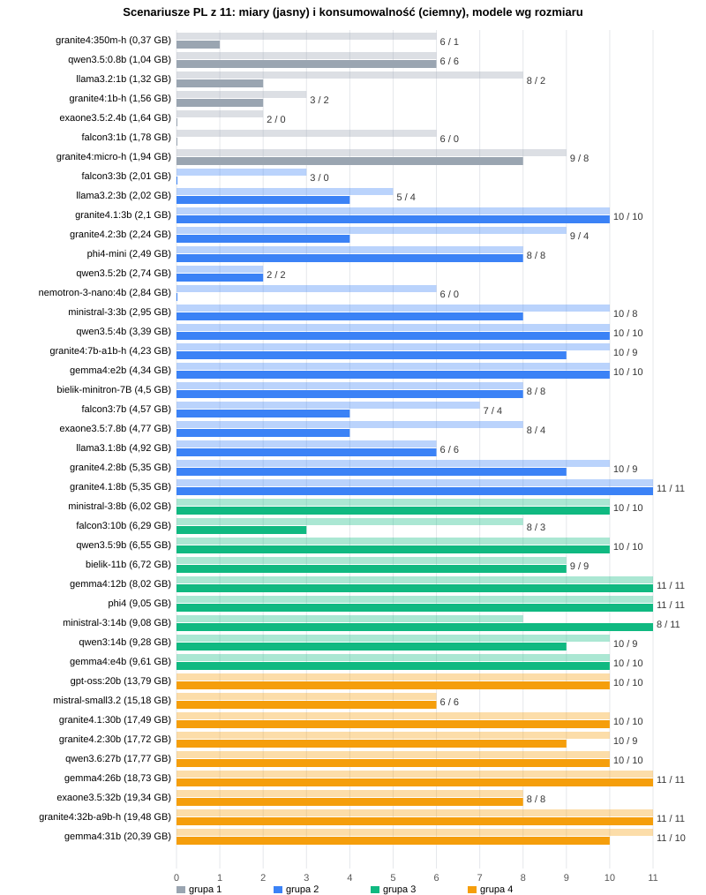

# Część 4. Wyniki

Ta część odpowiada na pytanie postawione na początku: **czy na komputerze, który stoi w domu, da się uruchomić model językowy robiący coś użytecznego.** Odpowiedź brzmi w skrócie: tak, ale sprzęt okazał się problemem mniejszym niż sam wybór modelu. 

Zapraszam do lektury wyników.

## 4.1. Jak czytać te wyniki

**Tabele zawierają dane. Ocena jest pod nimi.** Taki układ powtarza się w każdym rozdziale grupowym.

Najpierw spoglądam na same scenariusze a na końcu prezentuję wyniki modeli.

## 4.2. Wyniki scenariuszy

Bez zaskoczenia największą trudność sprawił modelom scenariusz najbardziej skomplikowany, z czterema spółkami, które ruszyły się naraz, a najmniejszą — scenariusze bez ruchu. Niespodzianką jest drugie miejsce: pojedynczy wzrost Modivo okazał się trudniejszy niż spadek Grupy Polsat o 5,34%, bo procent 2,299 trzeba zaokrąglić w górę, do 2,30, a wiele modeli go obcina albo skraca do jednego miejsca. Żaden scenariusz nie okazał się na tyle łatwy, żeby poradziły sobie z nim wszystkie 44 modele.

Oto scenariusze uszeregowane od najtrudniejszego:

| Scenariusz | Zestaw | Start | Modeli bez błędu w miarach | Modeli konsumowalnych |
|---|---|---|---:|---:|
| 21.09 11:00 — cztery spółki ▲ | 2 | ciepły | 20/44 | **15/44** |
| 23.09 17:00 — Modivo +2,30% ▲ | 1 | ciepły | 26/44 | 21/44 |
| 18.09 23:27 — Grupa Polsat −5,34% ▼ | 2 | ciepły | 28/44 | 23/44 |
| 19.10 13:00 — XTB −2,12% ▼ | 2 | ciepły | 32/44 | 23/44 |
| 18.09 15:00 — Grupa Polsat −2,63% ▼ | 2 | **zimny** | 33/44 | 26/44 |
| 19.10 09:00 — bez ruchu | 2 | ciepły | 39/44 | 26/44 |
| 23.09 13:00 — bez ruchu | 1 | ciepły | 36/44 | 28/44 |
| 23.09 09:00 — bez ruchu | 1 | **zimny** | 39/44 | 28/44 |
| 23.09 15:00 — bez ruchu | 1 | ciepły | 38/44 | 29/44 |
| 23.09 11:00 — bez ruchu | 1 | ciepły | 39/44 | 31/44 |
| 19.10 11:00 — bez ruchu | 2 | ciepły | 39/44 | 31/44 |

Model jest bez błędu w miarach w danym scenariuszu, jeśli w żadnej z czterech notatek automat nie znalazł błędu liczbowego (rozdział 3.4). Konsumowalny — jeśli wszystkie cztery notatki niosą prawdziwe i kompletne dane, nawet przy usterkach formy (rozdział 3.5.1).

Konsumowalnych jest prawie zawsze mniej niż bez błędu w miarach, bo konsumowalność jest kryterium ostrzejszym: nie przepuszcza procentu skróconego do jednego miejsca ani notatki, która w cyklu bez ruchu nie mówi, że zmian nie było. Najwięcej, od ośmiu do trzynastu modeli, odpada w cyklach bez ruchu: modele wypisują tam wbrew zakazowi kursy wszystkich spółek, a notatka nie mieści się w limicie długości i urywa się w pół zdania. Urwaną notatkę uznaję za niekonsumowalną, bo czytelnik nie wie, co zostało ucięte.

Najtrudniejszy scenariusz nie zastępuje pozostałych. Z 15 modeli, które poradziły sobie ze scenariuszem pierwszym, w którym zmieniają się cztery spółki naraz, wszystkie jedenaście scenariuszy z notatkami konsumowalnymi przechodzi sześć. Reszta potyka się na zaokrągleniu, na kursach z trzema miejscami po przecinku albo zmyśla zmiany w cyklach bez ruchu.

Modele, które poradziły sobie ze wszystkimi jedenastoma scenariuszami, pisząc za każdym razem notatkę konsumowalną, to: `granite4.1:8b` (grupa 2), `gemma4:12b` i `ministral-3:14b` (grupa 3) oraz `gemma4:26b`, `qwen3.8:27b` i `granite4:32b-a9b-h` (grupa 4). 

W tym gronie nie znalazł się ani jeden z modeli z grupy 1.

W tym gronie nie znalazł się żaden z modeli dodanych przeze mnie do listy wbrew zdrowemu rozsądkowi - z rodzin Falcon lub Exaone. Zaskakująco jednak, w tym gronie nie znalazł się również żaden z modeli polskich z rodziny Bielik.

## 4.3. Wyniki modeli

Każdy model ma trzy oceny i jeden pomiar rozstrzygający (kryteria opisuje rozdział 3.7):
- miary automatyczne,
- polszczyznę,
- konsumowalność,
- czas odpowiedzi — przy równych ocenach decyduje on o kolejności.

**Miary automatyczne odpowiadają na pytania sprawdzalne automatycznie:** czy podana została właściwa wartość procentowa, czy kierunek ruchu się zgadza, czy pojawiła się liczba, której nie było na wejściu, i czy procent nie został obcięty zamiast zaokrąglony. Wystarczy jedna taka pomyłka w którymkolwiek z jedenastu scenariuszy i czterech przebiegów, żeby model odpadł.

**Polszczyzna jest czytana z pełnych tekstów** — wszystkich czterdziestu czterech notatek każdego modelu — gdyż żadna metryka nie wykryje zdania poprawnego gramatycznie i pozbawionego sensu. Za wadę modelu uznaję błąd, który wraca w co najmniej dwóch przebiegach; błąd jednorazowy odnotowuję w komentarzu.

**Konsumowalność** rozstrzyga, czy notatka niesie prawdziwe i kompletne dane mimo usterek formy. Kropka dziesiętna zamiast przecinka jej nie odbiera — czytelnik i tak zrozumie liczbę poprawnie. Procent skrócony do jednego miejsca, zła kwota albo notatka, która w cyklu bez ruchu nie mówi, że zmian nie było, już tak.

Przy równych ocenach wygrywa model szybszy, a model na ustawieniach domyślnych aplikacji wyprzedza model, który wymaga osobnego wpisu w konfiguracji.

### 4.3.1. Zwycięzcy czterech grup

| Grupa | Zwycięzca | Plik | 11 scenariuszy: miary / konsumowalne | Polszczyzna | Narzędzia agenta | Ustawienia | Zimny start | Licencja | Architektura |
|---|---|---:|---|---|---|---|---:|---|---|
| 1 — poniżej 2 GB | **brak** | — | najlepszy `granite4:micro-h`: 9 / 6 | — | — | — | — | — | — |
| 2 — od 2 do 6 GB | `granite4.1:8b` | 5,35 GB | **11 / 11** | kropka dziesiętna, „spolki”, „Grupa Polsat wzrosło”, kursy w cyklach bez ruchu | 6/6, pętla 3/3 (14,4 s) | domyślne | 37,9 s | Apache 2.0 | gęsta (`granite`) |
| 3 — od 6 do 14 GB | `gemma4:12b` | 8,02 GB | **11 / 11** | **bez wad** | 6/6, pętla 3/3 (31,9 s) | domyślne | 34,6 s | Apache 2.0 | gęsta (`gemma4`), rozumowanie wyłączalne, multimodalna |
| 4 — powyżej 14 GB | `gemma4:26b` | 18,73 GB | **11 / 11** | **bez wad** | 6/6, pętla 3/3 (28,1 s) | domyślne | 34,3 s | Apache 2.0 | **MoE** (`gemma4`) — ~4 z 25 mld parametrów aktywnych |

Tak pisze `granite4.1:8b`, zwycięzca grupy drugiej, czyli tej, po którą sięgnie większość czytelników. W cyklu z ruchem, w trzech przebiegach na cztery:

> Modivo wzrosło o 2,30% do 97 PLN. Pozostałe spółki na liście nie doświadczyły znaczących zmian kursowych o co najmniej 2%.

A w cyklu bez ruchu:

> Brak spółek z listy zmienił kurs o co najmniej 2%. Aktualne kursy spółek pozostają takie, jak podane wcześniej: XTB 149.90 PLN, PKN Orlen 149.54 PLN, Grupa Kęty 1284.00 PLN, …

Liczby są prawdziwe w każdej notatce, także przy czterech spółkach naraz i przy obu spadkach Polsatu. Wady są w formie: w cyklach bez ruchu model wbrew zakazowi wypisuje wszystkie kursy, i to z kropką dziesiętną, a w zestawie drugim zdarza mu się „spolki” bez ogonków i „Grupa Polsat wzrosło”.

Dla porównania zwycięzcy grupy trzeciej i czwartej, za każdym razem tak samo:

> Spółka Modivo zmieniła kurs o 2,30% względem poprzedniego sprawdzenia. Aktualny kurs Modivo wynosi 97,00 PLN. Nie znam przyczyny tego ruchu. — `gemma4:12b`

> Modivo (MDV.WA) zmieniło kurs o 2,30%, a jego aktualna cena wynosi 97 PLN. Nie podano przyczyny tego ruchu. — `gemma4:26b`

**Grupa pierwsza nie ma zwycięzcy.** Pełne zestawienie jest dostępne [tutaj](./AI%20pod%20strzechy%2004a%20Wyniki%20grupa1.md), ale żaden z modeli tej grupy nie nadaje się do aplikacji piszącej po polsku. Najbliżej jest `granite4:micro-h`, który przechodzi w miarach 9 scenariuszy z 11, a z notatkami konsumowalnymi 6: obcina procenty („5,33%”), każdą notatkę o ruchu zaczyna od „Wczoraj” — umieszczenie wydarzeń w czasie wynika zapewne z jego danych treningowych, nie z promptu — i raz dopisuje zmyślone „CD Projekt wzruszyło się o 0,77%”. Nie pomogło ani wyjęcie z promptu zdania o zaokrąglaniu, ani przejście na angielski: po angielsku `granite4:micro-h` przechodzi test wszystkich cykli notowań z 23.09 z zestawu pierwszego, ale wszystkie modele grupy oblewają luźne scenariusze zestawu drugiego. W scenariuszu zmiany w kursie czterech spółek naraz każdy z nich gubi przynajmniej jedną, poza `qwen3.5:0.8b`, który podaje wszystkie cztery, tylko obcina procenty.

**Podium grupy drugiej jest zaskakująco kruche.** Grupę drugą wygrywa `granite4.1:8b` — jako jedyny w niej przechodzi wszystkie jedenaście scenariuszy, ale o jego słabościach napisałem już powyżej. Tuż za nim, już tylko z dziesięcioma scenariuszami na jedenaście, są dwa modele, każdy z inną słabością. `granite4.1:3b` jest z nich najszybszy (9,5 s zimnego startu), ale przy czterech spółkach naraz podaje same kursy, bez procentów. `qwen3.5:4b` w tym samym scenariuszu podaje zmiany w złotych zamiast procentów, i to zmyślone („Modivo o 3,92 PLN”). `gemma4:e2b` ma osiem: w cyklu o 17:00 zapisuje kurs Polsatu 15,965 zł jako „15965.00 PLN”, czyli tak, jakby wynosił piętnaście tysięcy, a wypisując wbrew zakazowi kursy wszystkich spółek, urywa część notatek na limicie długości. Najczystszą polszczyznę w grupie daje `ministral-3:3b`, ale procenty skraca do jednego miejsca po przecinku („−5,3%”), więc jego notatki w trzech scenariuszach nie są konsumowalne. W teście z promptem po angielsku bez wad pisze `llama3.2:3b`, ale po polsku przechodzi tylko cztery scenariusze.

**Model `gemma4:12b` jest wyraźnym liderem grupy trzeciej.** Jako jedyny w tej grupie pisze po polsku bez wady powtarzalnej, a test scenariuszy z dnia 23.09, czyli z zestawu pierwszego, za każdym razem tak samo — w cyklu bez ruchu „Nie było znaczących zmian w kursach spółek na liście.” Procent z piętnastoma miejscami po przecinku zaokrągla sam, kurs „97” uzupełnia do „97,00”, pisze przecinkiem i nie wymienia kursów, kiedy nie trzeba. W zestawie drugim zdarza mu się jedynie kropka dziesiętna przy spadku Polsatu o 5,34% (przy obu spadkach Polsatu, w 5 notatkach z 8). Wszystkie jedenaście scenariuszy przechodzi w tej grupie jeszcze `ministral-3:14b`. Przegrywa z `gemma4:12b` polszczyzną — wbrew zakazowi wypisuje kursy pozostałych spółek, tak jak zwycięzca grupy drugiej, który jednak w swojej grupie nie miał rywala z kompletem scenariuszy. `phi4` ma dziewięć: też wypisuje kursy wszystkich spółek i w trzech notatkach wyczerpuje przy tym limit długości, a notatka urywa się w pół słowa („Nie znane są przyczyny ruch”). 

**Grupa czwarta ma lidera zdecydowanego — i jest nim także model Gemma 4: `gemma4:26b`.** Przeszedł bez uwag wszystko, co sprawdzałem: jedenaście scenariuszy, test bez polecenia zaokrąglania, prompt po angielsku i narzędzia agenta. Spadki zapisuje z przecinkiem i poprawnie zaokrągla („Grupa Polsat zmieniła kurs o -5,34%”), przy czterech spółkach naraz nie gubi żadnej, a bez ruchu za każdym razem pisze „Nie było znaczących zmian na liście spółek.”

Jest przy tym najszybszy w swojej grupie spośród modeli na ustawieniach domyślnych (34,3 s zimnego startu) i szybszy od mniejszego zwycięzcy grupy trzeciej: plik ma ponad dwa razy większy, ale jako model MoE przy każdym tokenie używa tylko około 4 z 25 mld parametrów — z załadowanym modelem kolejna notatka zajmuje mu 13 s, `gemma4:12b` 23 s. Haczyk jest jeden: 18,73 GB pliku to model na komputer z 32 GB RAM i Ollamę uruchomioną bezpośrednio w systemie, nie w kontenerze.

**Drugi jest `qwen3.8:27b` — i to najlepszy w badaniu przykład, że aktualizacja modelu ma sens.** To ten sam model bazowy co `qwen3.6:27b` (rodzina `qwen35`, 27,3 mld parametrów), tylko w nowszym wydaniu, i naprawia jedyny błąd poprzednika: przy czterech spółkach naraz za każdym razem podaje wszystkie cztery procenty. Przechodzi wszystkie jedenaście scenariuszy, pisze po polsku bez wad i ma komplet w teście narzędzi — a do tego startuje szybciej (61 s wobec 73,5 s) i domyka pętlę narzędziową w 51 s zamiast 125 s. Kto ma `qwen3.6:27b`, zyskuje na podmianie w każdym mierzonym wymiarze.

Trzeci jest `granite4:32b-a9b-h` (46,7 s): też przechodzi wszystkie jedenaście scenariuszy, a przegrywa formą — o 17:00 wypisuje kursy pozostałych spółek z kropką dziesiętną. Dalej `gemma4:31b` (67,7 s), który pisze bez wad, ale raz skraca procent do „2,3%” i traci przez to jeden scenariusz. `laguna-xs-2.1` od Poolside (38,7 s), model MoE z około 3 mld aktywnych parametrów, jest po Gemmie najszybsza w grupie i liczby podaje bezbłędnie, ale pisze rozwlekle: w czterech notatkach wyczerpuje limit długości i traci przez to cztery scenariusze, dopisuje „Dane z dnia dzisiejszego” i twierdzi, że kursy „pozostają bez zmian”, choć się zmieniły. Najszybszy w grupie `gpt-oss:20b` (24,4 s) raz zwraca pustą notatkę i jako jedyny potrzebuje osobnego ustawienia w konfiguracji.

**Zwycięzców wszystkich trzech grup dali dwaj producenci: Google i IBM.** Najlepsze modele badania w języku polskim nie są ani polskie, ani nawet europejskie — są amerykańskie. Spośród modeli europejskich najbliżej zwycięstwa okazał się francuski `ministral-3:14b`, który w grupie trzeciej przechodzi wszystkie jedenaście scenariuszy, ale przegrywa polszczyzną.

**W żadnej z grup nie ma na pierwszym miejscu polskiego modelu Bielik.** Najwyżej z nich jest `bielik-11b`: przechodzi dziewięć scenariuszy z jedenastu. Dwa cykle bez ruchu traci przez kursy Polsatu 16,105 i 16,005 zł zapisane jako „16.105.00 PLN” i „16.005.00 PLN”. Pozostałe jego wady nie odbierają notatkom konsumowalności: wbrew poleceniu pisze kropkę dziesiętną („Modivo (MDV.WA) wzrosło o 2.30% do 97 PLN.”), a w cyklach bez ruchu wbrew zakazowi wypisuje kursy wszystkich spółek i zaczyna notatkę od niegramatycznego „Brak spółek zmieniło kurs o co najmniej 2%”. Mniejszy `bielik-minitron-7B` przechodzi osiem scenariuszy: procent `2.299…` obcina do „2,29%” zamiast zaokrąglić, a w scenariuszach ze spadkami gubi minus i pisze „XTB wzrosło o 2.12%” o spółce, która spadła.

**Grupa czwarta dała najpewniejszego zwycięzcę całego badania — ale najtrudniej z niej skorzystać.** Mogłem z niej w ogóle skorzystać dlatego, że mój komputer ma 32 GB RAM. Musiałem przy tym zrezygnować z konteneryzacji: każdy model z tej grupy uruchamiałem na osobnej Ollamie, zainstalowanej bezpośrednio w systemie, przy zatrzymanym Podmanie — a więc i przy wyłączonej aplikacji. To modele zajmujące najwięcej pamięci i niektóre ledwo się mieściły: `exaone3.5:32b` po załadowaniu zajmuje prawie 22 GB, a wolnej pamięci zostawało niewiele ponad gigabajt. Aby go uruchomić, musiałem pozamykać przeglądarki i inne programy, a w jednym z podejść skrypt w ogóle go odłożył z braku pamięci. Na komputerze, który ma jednocześnie służyć do pracy, taki model nie jest praktycznym wyborem. Konfiguracyjnie wyróżnia się tylko `gpt-oss:20b`, który nie pozwala wyłączyć rozumowania i wymaga ustawienia jego najniższego poziomu. Mimo tych trudności podium grupy czwartej — `gemma4:26b`, `qwen3.8:27b` i `granite4:32b-a9b-h`, wszystkie na licencji Apache 2.0 — podaje liczby poprawnie we wszystkich scenariuszach, a zwycięzca przeszedł bez uwag wszystkie sprawdziany, także po angielsku i z narzędziami agenta.

**Architektura mówi więcej niż rozmiar.** Rozmiar pliku mówi, ile pamięci model zajmie, a nie ile czasu zajmie odpowiedź. Modele typu MoE, w których przy każdym tokenie pracuje tylko część sieci, są wyraźnie szybsze od gęstych tej samej wielkości. `gemma4:26b` z około 4 mld aktywnych parametrów pisze kolejną notatkę w 13 s, a gęsty `gemma4:31b` w 46 s. `granite4:32b-a9b-h` (~9 mld aktywnych) startuje w 47 s, gęsty `granite4.1:30b` w 68 s, a `laguna-xs-2.1` z około 3 mld aktywnych z 33 mld pisze kolejną notatkę w 16 s. Szybkość nie przekłada się jednak na jakość: najmniejszy MoE w badaniu, `granite4:7b-a1b-h`, przechodzi dziesięć scenariuszy z jedenastu, ale procentu nie zaokrągla, tylko przepisuje go z piętnastoma miejscami po przecinku, a przy czterech spółkach naraz gubi jedną z nich. Rozumowanie, w tym zadaniu zbędne, przy odpowiednim ustawieniu nie musi szkodzić: `gpt-oss:20b` z najniższym poziomem rozumowania ma najkrótszy zimny start w grupie czwartej. Architektura nie tłumaczy natomiast polszczyzny. Oba Bieliki deklarują w manifeście architekturę `llama` — tę samą co `llama3.1:8b` od Meta, który gubi jedyny ruch dnia, i obie małe Llamy, które odpadają na liczbach. Trzy duże Granite o tej samej budowie piszą po angielsku bez wad, a po polsku z wadami. O tym, kto pisze po polsku poprawnie, decyduje to, na czym model był trenowany, a nie to, jak jest zbudowany.

## 4.4. Jakość: miary kontra polszczyzna

Testów po polsku nie zdał żaden model z rodzin, które polskiego w ogóle nie deklarują — EXAONE ani Falcon — i tu zdrowy rozsądek sprzed rozpoczęcia badania się potwierdził. Ale oblały je także modele, które polski deklarują. Jak więc wypadają pod względem polszczyzny badane modele ogólnie?

| Grupa | W grupie | Test z rozdz. 3 bez błędu liczbowego | Wszystkie 11 scenariuszy w miarach | Wszystkie 11 scenariuszy konsumowalnych | Bez wad polszczyzny |
|---|---:|---:|---:|---:|---:|
| 1 — poniżej 2 GB | 7 | 0 | 0 | 0 | **0** |
| 2 — od 2 do 6 GB | 17 | 7 | 1 | 1 | **0** |
| 3 — od 6 do 14 GB | 9 | 6 | 2 | 2 | **1** |
| 4 — powyżej 14 GB | 11 | 9 | 5 | 3 | **4** |
| **Razem** | **44** | **22** | **8** | **6** | **5** |

Wada polszczyzny to błąd, który wraca w co najmniej dwóch z czterech przebiegów testu z rozdziału trzeciego.

Im większy model, tym rzadziej myli się w liczbach: wszystkie jedenaście scenariuszy przechodzi zero modeli w grupie pierwszej, jeden w drugiej, dwa w trzeciej i trzy w czwartej (z notatkami konsumowalnymi). Polszczyzna jest jeszcze trudniejsza. Bez wady językowej pisze pięć modeli na czterdzieści cztery — `gemma4:12b`, `gemma4:26b`, `gemma4:31b`, `qwen3.6:27b` i `qwen3.8:27b` — wszystkie z dwóch górnych grup. W grupie drugiej, najliczniejszej i najbardziej praktycznej, nie pisze tak żaden.

Obie oceny nie idą w parze. Granite z kompletem scenariuszy — `granite4.1:8b` i `granite4:32b-a9b-h` — podają liczby bezbłędnie, ale piszą z kropką dziesiętną i wypisują kursy wbrew zakazowi. `qwen3.6:27b` pisze bez wad, ale przy czterech spółkach naraz gubi procenty — jego następca `qwen3.8:27b` już nie. Komplet scenariuszy i polszczyznę bez wad mają jednocześnie trzy modele: `gemma4:12b`, `gemma4:26b` i `qwen3.8:27b`.

Miary i konsumowalność nie zgadzają się ani co do liczby, ani co do składu. Wszystkie jedenaście scenariuszy przechodzi w miarach osiem modeli, a z notatkami konsumowalnymi sześć. Tylko w miarach przechodzą `gemma4:31b` — automat zalicza „2,3%”, konsumowalność już nie — oraz `phi4` i `laguna-xs-2.1`, których notatki urywają się na limicie długości: automat sprawdza liczby, które w notatce są, a nie to, czego w niej zabrakło. Tylko w konsumowalności przechodzi `ministral-3:14b`, bo automat liczy kropkę jako separator tysięcy („1.288,00 PLN”) za zmyśloną kwotę. Wszystkie te rozbieżności wyszły dopiero przy lekturze.

*Liczba scenariuszy z jedenastu, które model przeszedł bez błędu w miarach (słupek jasny) i z notatkami konsumowalnymi (słupek ciemny). Modele uszeregowane od najmniejszego, kolor oznacza grupę wielkości. Dane w pliku [scenariusze-pl-11.csv](./scenariusze-pl-11.csv).*

Wykres pokazuje też, że rozmiar podnosi dolną granicę, a nie górną. Komplet jedenastu scenariuszy pojawia się dopiero od 5,35 GB, ale wyniki dziewięć–dziesięć zdarzają się już od 2 GB, a do samego końca stawki trafiają się modele słabe. Najwyraźniej widać też, gdzie konsumowalność rozchodzi się z miarami: w grupie pierwszej, w której automat zaliczał cykle bez ruchu modelom, które nie podawały żadnych liczb.

Przykłady wad, których nie wykryła żadna metryka:
- model wkleja do notatki fragment polecenia („nie wymieniaj kursów i pod żadnym pozorem…”),
- dopisuje pytanie do użytkownika,
- wypisuje wszystkie kursy wbrew wyraźnemu zakazowi,
- wymyśla słowa takie jak „Ruchnoty” albo „wzyskało”,
- zapisuje polskie słowo cyrylicą,
- dopisuje datę, której nie było w danych,
- każdą notatkę o ruchu zaczyna od „Wczoraj”.

Pułapka polega na tym, że każde z tych zdań jest po polsku, kończy się kropką i nie zawiera fałszywej liczby.

Liczby są łatwe. Zdanie po polsku jest trudne.

## 4.5. Czy model zadziałał na ustawieniach domyślnych mojej aplikacji

**Wszystkie czterdzieści cztery modele działają, a czterdzieści trzy na ustawieniach domyślnych aplikacji:** `/api/generate`, `think: false`, 180 tokenów na odpowiedź, temperatura 0,2 i okno kontekstu domyślne dla Ollamy. Pobrać, wysłać zapytanie, dostać notatkę.

Wyjątkiem jest `gpt-oss:20b`. Nie pozwala wyłączyć rozumowania — `think: false` jest dla niego nieznaną wartością i Ollama podstawia wtedy domyślny poziom „medium”. Wymaga więc jednego wpisu w konfiguracji aplikacji, `think: "low"`, czyli najniższego poziomu rozumowania. Z tym wpisem działa na tych samych 180 tokenach i ma najkrótszy zimny start w grupie czwartej.

Wpis jest udokumentowany i zajmuje jedną linię, ale nie jest obojętny: przy równych ocenach model na ustawieniach domyślnych wyprzedza model, który go wymaga. Każdy taki wyjątek to coś, o czym trzeba wiedzieć, zanim podmieni się model w aplikacji.

Osobną sprawą jest infrastruktura, a nie ustawienia: jedenaście modeli grupy czwartej nie zmieściło się w kontenerze i uruchamiałem je na Ollamie zainstalowanej bezpośrednio w systemie, przy zatrzymanym Podmanie — więcej w rozdziale 3.2.

## 4.6. Czy da się zbudować pętlę narzędziową

**Zbudowanie pętli narzędziowej nie było częścią rankingu.** Sprawdziłem jednak, czy na tym samym sprzęcie da się zbudować zalążek agenta — model prosi o funkcję, kod ją naprawdę wykonuje, a model odpowiada na podstawie wyniku.

Test miał dwa kroki, oba po polsku. W pierwszym model dostaje dwa narzędzia — kurs historyczny spółki i listę monitorowanych spółek — i dwa pytania po trzy razy, czyli sześć prób wywołania. W drugim pyta o kurs zamknięcia LPP sprzed pięciu dni; kod zwraca prawdziwy wynik z bazy — 24 160 zł z 19 września — a model ma go przekazać w jednym zdaniu. Trzy próby, sprawdzana poprawność liczby. Kontrola liczby porównywała początkowo same cyfry i przepuszczała „241,60 PLN” jako 24 160 zł; po poprawce porównuje wartość, a wyniki przeliczyłem z zapisanych odpowiedzi. Czasy są średnimi z prób; pierwsza próba każdego modelu startowała na zimno.

| Grupa | Modeli | Komplet (6/6 wywołań, 3/3 pętli) | Niepełny wynik | Odrzucone przez Ollamę | Najszybszy z kompletem (czas pętli) | Zwycięzca grupy z 4.3.1 w teście narzędzi |
|---|---:|---:|---:|---:|---|---|
| 1 — poniżej 2 GB | 7 | 4 | 1 | 2 | `granite4:350m-h` 1,3 s | — |
| 2 — od 2 do 6 GB | 17 | 11 | 3 | 3 | `llama3.2:3b` 4,8 s | `granite4.1:8b`: komplet, 14,4 s, ale datę wymyśla |
| 3 — od 6 do 14 GB | 9 | 4 | 3 | 2 | `bielik-11b` 17,6 s | `gemma4:12b`: komplet, 31,9 s |
| 4 — powyżej 14 GB | 11 | 9 | 1 | 1 | `gpt-oss:20b`\* 14,6 s | `gemma4:26b`: komplet, 28,1 s |
| **Razem** | **44** | **28** | **8** | **8** | | |

\* Wymaga wpisu `think: "low"` w konfiguracji; najszybszy na ustawieniach domyślnych jest `granite4:32b-a9b-h` (25,8 s).

**Komplet ma 28 modeli na 44, częściej duże niż małe** — dziewięć na jedenaście w grupie czwartej. Najsłabiej wypada grupa trzecia, w której komplet ma tylko czterech z dziewięciu.

**Rozmiar nie decyduje jednak o tym, czy model w ogóle umie używać narzędzi.** Osiem modeli Ollama odrzuca od razu, bo ich manifest nie deklaruje narzędzi: cztery Falcony, trzy EXAONE i `phi4` — ten ostatni przechodzi dziewięć scenariuszy notatki z jedenastu, ale agentem nie będzie. Spośród ośmiu z niepełnym wynikiem najdalej od celu są trzy, które narzędzia deklarują, a nie potrafią ich użyć: `phi4-mini` opisuje wywołanie słowami, zamiast je wykonać, `ministral-3:14b` zapisuje je jako tekst (`kurs_historyczny[ARGS]{…}`), a `qwen3:14b` wywołuje bezbłędnie, ale po otrzymaniu wyniku zwraca pustą odpowiedź. Tego nie wykryje nic poza uruchomieniem testu.

Najszybciej pętlę domykają najmniejsze modele: `granite4:350m-h` za 0,37 GB robi to w 1,3 sekundy, a całą pierwszą dziewiątkę zajmują modele z grup pierwszej i drugiej. Zwycięzcy grup są dalej — `granite4.1:8b` dziesiąty (14,4 s), `gemma4:26b` siedemnasty (28,1 s), `gemma4:12b` dziewiętnasty (31,9 s) — ale wszyscy trzej mają komplet.

Okazało się, że **Ollama ma też jedną pułapkę.** Punkt końcowy `/api/generate`, którego używa moja aplikacja do notatek, przyjmuje parametr `tools`, odpowiada kodem 200 i po cichu go ignoruje — bez błędu i bez ostrzeżenia. Narzędzia działają wyłącznie przez `/api/chat`.

**Czy halucynacja wraz z użyciem narzędzi znika? Nie.** Narzędzie zwraca kurs razem z datą notowania, a trzy modele datę wymyślają same: zwycięzca grupy drugiej `granite4.1:8b` za każdym razem pisze „z 5 dni temu (2025-08-29)”, a oba Ministrale „19 października 2026”. `ministral-3:3b` idzie dalej i kurs 24 160 zł podaje jako „241,60 PLN” — ten sam błąd przesuniętego przecinka, który w notatkach popełniał `mistral-small3.2` — a `laguna-xs-2.1`, w notatkach bezbłędna w liczbach, w pętli za każdym razem pisze „24,16 PLN”. Oddelegowanie pracy do narzędzia chroni więc tylko te pola, które model zdecyduje się przeczytać.

Do notatki i do agenta jednocześnie — z kompletem jedenastu scenariuszy, polszczyzną bez wad i kompletem w teście narzędzi — nadają się trzy modele: `gemma4:12b` za 8 GB, `gemma4:26b` za 18,7 GB i `qwen3.8:27b` za 17,7 GB.

Zastrzeżenie: zadanie w pętli jest prostsze od notatki — jeden fakt w jednym zdaniu zamiast nazwy, procentu i kursu naraz — i mierzone było trzema próbami, nie czterema przebiegami po jedenaście scenariuszy. Kolejność z tego testu traktuję więc jako orientacyjną, a sam wynik — że się da — jako pewny.

Wniosek praktyczny: **kto przeniesie wybór danych i formatowanie do kodu, a modelowi zostawi jedno zdanie do powiedzenia, nie potrzebuje dużego modelu.** Potrzebuje takiego, który poprawnie woła narzędzia — a to potrafi już model za kilkaset megabajtów. Daty i liczby, które mają trafić do użytkownika, i tak warto brać z wyniku narzędzia w kodzie, a nie z odpowiedzi modelu.

## 4.7. Co jest w rozdziałach grupowych

Każda grupa ma własny rozdział o tej samej budowie:
- zestawienie modeli — wyniki wszystkich testów, główne problemy po polsku i po angielsku, zimny start, rozmiar, licencja, narzędzia i data dodania do biblioteki Ollamy,
- wyniki per scenariusz — ile modeli grupy poradziło sobie z każdym z jedenastu scenariuszy i który najszybciej,
- pełne teksty odpowiedzi — wszystkie notatki z cykli z ruchem i różne wersje notatek z cykli bez ruchu, z liczbą wystąpień,
- komentarz i ranking końcowy.

- [**Grupa 1 — poniżej 2 GB.**](./AI%20pod%20strzechy%2004a%20Wyniki%20grupa1.md) Dolna granica sensu. Żaden model nie przechodzi wszystkich scenariuszy ani po polsku, ani po angielsku — dla tej grupy dołożyłem badanie ratunkowe, zestaw drugi z promptem angielskim, i ono też nie dało kandydata.
- [**Grupa 2 — od 2 do 6 GB.**](./AI%20pod%20strzechy%2004b%20Wyniki%20grupa2.md) Serce badania i najliczniejsza grupa: siedemnaście modeli, które mieszczą się na komputerze z 16 GB bez karty graficznej. Wszystkie jedenaście scenariuszy przechodzi tu tylko jeden model, a tuż za nim stoją trzy z dziesięcioma, każdy z inną słabością — wynik najważniejszy i zarazem najmniej jednoznaczny.
- [**Grupa 3 — od 6 do 14 GB.**](./AI%20pod%20strzechy%2004c%20Wyniki%20grupa3.md) Trzy modele z konsumowalnym kompletem scenariuszy i jedyny w grupie z polszczyzną bez wad, `gemma4:12b`. Zarazem najsłabsza grupa pod kątem narzędzi: komplet w teście narzędzi ma w niej tylko czterech z dziewięciu.
- [**Grupa 4 — powyżej 14 GB.**](./AI%20pod%20strzechy%2004d%20Wyniki%20grupa4.md) Mierzona wyłącznie na Ollamie zainstalowanej w systemie, przy zatrzymanym Podmanie. Daje najpewniejszego zwycięzcę badania i odpowiada na pytanie, co traci ten, kto zatrzymuje się na tańszym sprzęcie.

